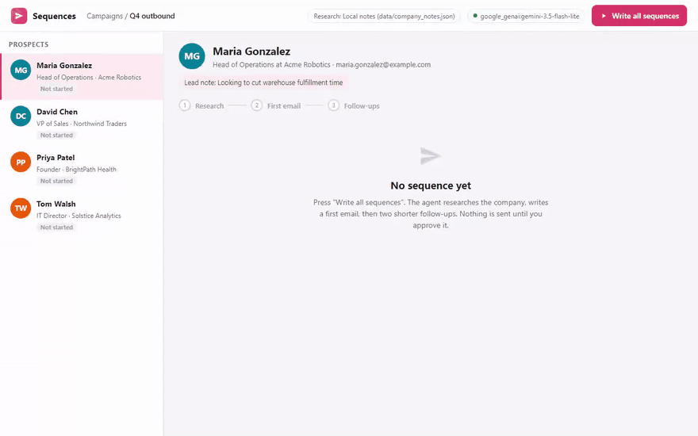

<h1>AI Sales Outreach Agent</h1>

<b>Researches each lead, writes a cold email that mentions something real about their company, drafts two follow-ups, and then waits for a person to approve it.</b>

  
  
  
  
  
  

  <a href="#what-it-does">What it does</a> &nbsp;|&nbsp;
  <a href="#how-it-works">How it works</a> &nbsp;|&nbsp;
  <a href="#sample-run">Sample run</a> &nbsp;|&nbsp;
  <a href="#quick-start">Quick start</a> &nbsp;|&nbsp;
  <a href="#configuration">Configuration</a> &nbsp;|&nbsp;
  <a href="#roadmap">Roadmap</a>

 

<h2>See it in action</h2>

Recorded from a real run on Google Gemini (<code>gemini-3.5-flash-lite</code>) on 12 November 2026. Nothing is edited or scripted. Only the waiting time while the model thinks is shortened. <a href="demo/demo.mp4">Download the MP4</a>.

<h2>The problem</h2>

Most AI outreach tools are mail merge with extra steps. A name and a company go into a template and the email goes out at volume. Prospects have seen thousands of these and delete them on sight.

What gets replies is an email that reads like someone spent two minutes looking at the company first. That is slow to do by hand, and it is a good fit for an AI model, as long as the research is real and the writing avoids the usual tells.

<h2>What it does</h2>

<table>
  <tr><th align="left">Capability</th><th align="left">What that means in practice</th></tr>
  <tr><td><b>Lead research</b></td><td>Looks up each company with Tavily, or reads local notes when no search key is set, so the personalisation shows in a demo before you pay for anything.</td></tr>
  <tr><td><b>A first email that sounds human</b></td><td>Three to five sentences, one specific detail about the company and a low-pressure ask. Openers like "I hope this email finds you well" are banned in the prompt.</td></tr>
  <tr><td><b>Two follow-ups</b></td><td>Day 3 and day 7. Each one has to add something new, and the last one makes it easy to say no.</td></tr>
  <tr><td><b>Human approval</b></td><td>You review every lead's emails in the terminal and approve or skip each one.</td></tr>
  <tr><td><b>Safe by default</b></td><td>Dry run unless you pass <code>--send</code>, and even then it asks again before each real email.</td></tr>
  <tr><td><b>Spreadsheet export</b></td><td>Every draft lands in <code>output/outreach_drafts.csv</code>. Progress is saved even if you stop halfway with Ctrl+C.</td></tr>
</table>

<h2>How it works</h2>

<pre>
lead from CSV --&gt; research company --&gt; write first email --&gt; write 2 follow-ups
                                                                    |
                         you approve or skip  &lt;---------------------+
                                |
                    dry run (default) or --send with a second confirmation
</pre>

A short LangGraph pipeline runs the same three steps for every lead: research, first email, follow-ups. Each draft comes back through a Pydantic model, so you always get a clean subject line and body.

Sending uses plain SMTP, so it works with Gmail, Outlook or any mail provider. Set <code>SENDER_NAME</code> and every email is signed with your name.

<h2>Decisions I made on purpose</h2>

<h3>It doesn't send on its own</h3>

Cold email goes out under a real person's name. A wrong claim about someone's company, or a tone that doesn't fit the brand, costs the sender's reputation. So the default is a dry run, and a real send takes an explicit flag plus a confirmation for each lead.

<h3>No LinkedIn automation</h3>

LinkedIn has no official API for sending messages, and automating it puts the account at risk of being restricted. The agent drafts the message and a person sends it. I would rather explain that limit to a client up front than explain a banned sales account afterwards.

<h2>Sample run</h2>

A real run on Google Gemini, one of the four demo leads:

<pre>
Lead: Maria Gonzalez (Head of Operations at Acme Robotics)
------------------------------------------------------------
INITIAL EMAIL
Subject: Fulfillment ops at Acme Robotics
I noticed Acme Robotics is actively expanding into the Midwest and building out
your fulfillment operations team. As you scale hardware delivery, keeping
warehouse fulfillment times down is likely a top priority for your group. ...
Would you be open to a brief 10-minute call next week to see if this aligns
with your goals?

FOLLOW-UP 1
Subject: Quick resource for Acme's Midwest expansion
...
FOLLOW-UP 2
Subject: Closing the loop re: Acme ops workflow
Hi Maria, I am guessing optimizing fulfillment timelines during your Midwest
rollout isn't a top priority right now. If the timing is off, no problem at
all. Should I close the loop for now, or check back in next quarter?
============================================================
Approve this outreach? [y]es / [s]kip:
</pre>

<h2>Quick start</h2>

You need Python 3.12 or newer and an API key from OpenAI, Anthropic or Google Gemini.

<pre>
pip install -r requirements.txt
cp .env.example .env        # on Windows: copy .env.example .env
# open .env and paste your API key
python process_leads.py            # dry run, nothing is sent
python process_leads.py --send     # real sending, asks again per lead
</pre>

Leads come from <code>data/leads.csv</code>. Swap in your own list with the same columns.

<h2>Configuration</h2>

Everything is set in <code>.env</code>. Copy <code>.env.example</code> to start.

<table>
  <tr><th align="left">Variable</th><th align="left">Required</th><th align="left">Purpose</th></tr>
  <tr><td><code>LLM_MODEL</code></td><td>Yes</td><td>Which model to use, as <code>provider:model</code>. Default <code>openai:gpt-5.5</code>. Also works with <code>anthropic:claude-opus-5-5</code> or <code>google_genai:gemini-3.5-flash</code>.</td></tr>
  <tr><td><code>OPENAI_API_KEY / ANTHROPIC_API_KEY / GOOGLE_API_KEY</code></td><td>One of them</td><td>The key for whichever provider you picked.</td></tr>
  <tr><td><code>TAVILY_API_KEY</code></td><td>No</td><td>Live company research. Without it the agent reads <code>data/company_notes.json</code>.</td></tr>
  <tr><td><code>SENDER_NAME</code></td><td>No</td><td>Your name for the email sign-off.</td></tr>
  <tr><td><code>SMTP_HOST, SMTP_PORT, SMTP_USERNAME, SMTP_PASSWORD, SMTP_FROM_ADDRESS</code></td><td>Only with --send</td><td>Mail server details for real sending. For Gmail, use an app password.</td></tr>
</table>

<h2>Project structure</h2>

<pre>
ai-sales-outreach-agent/
  .env.example                                           # copy to .env and add your key
  case_study.md                                          # longer write-up of the design
  process_leads.py                                       # runs the batch with the approval prompt
  README.md
  requirements.txt                                       # dependencies
  .git/
    COMMIT_EDITMSG
    config
    description
    HEAD
    hooks/applypatch-msg.sample
    hooks/commit-msg.sample
    hooks/fsmonitor-watchman.sample
    hooks/post-update.sample
    hooks/pre-applypatch.sample
    hooks/pre-commit.sample
    hooks/pre-merge-commit.sample
    hooks/pre-push.sample
    hooks/pre-rebase.sample
    hooks/pre-receive.sample
    hooks/prepare-commit-msg.sample
    hooks/push-to-checkout.sample
    hooks/sendemail-validate.sample
    hooks/update.sample
    index
    info/exclude
    logs/HEAD
    logs/refs/heads/main
    logs/refs/remotes/origin/main
    objects/00/4d121b442f05c01b64d5aa9403b5d53806f65b
    objects/0d/19a37d674a332b9dba9f34ec54f3144a81a21f
    objects/10/58a1802dcc262e94668fa970c4d856afffd41e
    objects/10/6edddf83ee77cbcfbc56428edc0794d5ad883f
    objects/36/c3486cf20a1e8c68c381b78e68616a4027cbe1
    objects/41/2240f488cf2af75f18c4ff42bff4508d700d38
    objects/4e/4af010b8de015ae0f0e1872e998653fb04d5cc
    objects/78/998da0758f803a8b7d9b492206632524003f81
    objects/7a/3a4f0ab20b8170a7b714479283340f5fe09e10
    objects/8b/d4ae4e401a098e898fe9e025ae17f3bdd82cfa
    objects/91/741a425461ba419e95f39dc5d88278bfffb12e
    objects/a2/667477f906e25e4d46862b73a0cf1d10163a78
    objects/a7/14d955d62209cd096b028913ca9644ae128527
    objects/b1/de0ebc60c06839298476a3eff78a9757a6bb09
    objects/b5/ff3a9e767ce808891018a618a688c387555050
    objects/bb/1d0d20270c6b562a687dd6c5e21f3c4d7ba090
    objects/c1/d430221fc4883e4d6a72b778dc43d3dd8bea28
    objects/c2/dd3fcfb07ebee812b422c718bcd3557a398df5
    objects/c5/4aeb32cf364cf433dfb7c8ce58583bc231b3a2
    objects/c5/97c23fa30e7a1e2dfac8278bb520f879e325c9
    objects/c6/beecc22a1dd89f074b060e510f303738bae561
    objects/cf/1303a63b951fa6ec27a6ba48059cc0dc64f141
    objects/de/746f20e8d94bc4bca3a762ef31b38beac8dfce
    objects/e5/6d0464232e3f00c54b6317bcda0a87126ef783
    objects/e6/9de29bb2d1d6434b8b29ae775ad8c2e48c5391
    objects/ea/2d6533c341e94f0947299ec405fffd79901dc6
    objects/eb/e9e744f03bcbd6a41b902a82f36202d82c69d6
    refs/heads/main
    refs/remotes/origin/main
  agent/
    email_sender.py                                      # SMTP sending
    llm.py                                               # picks the model from LLM_MODEL
    outreach.py                                          # the LangGraph pipeline and prompts
    research.py                                          # Tavily lookup with the local fallback
  data/
    company_notes.json                                   # offline research notes for the sample companies
    leads.csv                                            # four sample leads
  demo/
    demo.gif
    demo.mp4
  tests/                                                 # pytest suite, runs without any API key
</pre>

<h2>Built with</h2>

Python &nbsp;&middot;&nbsp; LangGraph &nbsp;&middot;&nbsp; LangChain &nbsp;&middot;&nbsp; Pydantic &nbsp;&middot;&nbsp; Tavily &nbsp;&middot;&nbsp; SMTP &nbsp;&middot;&nbsp; OpenAI / Anthropic / Gemini

<h2>Tests</h2>

<pre>
pip install -r requirements-dev.txt
pytest
</pre>

Five tests cover the research fallback, the dry-run default, missing mail settings, the email signature and the CSV export. None of the tests call a model or need an API key, so they run on GitHub Actions on every push. The badge at the top shows the latest result.

<h2>Roadmap</h2>

What I would build next if a client took this into production:

<ul>
  <li>A scheduler with reply detection, so follow-ups only go to leads who haven't answered. This is the first thing I would build for a client.</li>
  <li>Pulling leads straight from HubSpot, Pipedrive or another CRM instead of a CSV</li>
  <li>Daily sending limits and warm-up for better deliverability at higher volume</li>
</ul>

<h2>More from this series</h2>

Nine production-minded AI agents, each solving one business problem properly.

<table>
  <tr><td><a href="https://github.com/saqib-n/ai-research-report-agent"><b>Research Report Agent</b></a></td><td>Researches a topic, notices its own gaps, and writes a report with a source for every claim.</td></tr>
  <tr><td><a href="https://github.com/saqib-n/ecommerce-automation-agent"><b>E-commerce Order and Inventory Agent</b></a></td><td>Shopify order, stock and returns assistant, plus a monitor that warns you before stock runs out.</td></tr>
  <tr><td><a href="https://github.com/saqib-n/email-triage-agent"><b>Email Triage Agent</b></a></td><td>Sorts an inbox into four buckets and gives each one a different level of autonomy.</td></tr>
  <tr><td><a href="https://github.com/saqib-n/lead-qualification-crm-agent"><b>Lead Qualification Agent</b></a></td><td>Scores inbound leads against your own rubric and pushes the good ones to HubSpot.</td></tr>
  <tr><td><a href="https://github.com/saqib-n/multi-agent-customer-support"><b>Multi-Agent Customer Support</b></a></td><td>A router plus specialist agents for orders, refunds, FAQs and human handoff.</td></tr>
  <tr><td><a href="https://github.com/saqib-n/rag-knowledge-base-agent"><b>RAG Knowledge Base Agent</b></a></td><td>Answers questions from your own documents and names the source for every answer.</td></tr>
  <tr><td><a href="https://github.com/saqib-n/recruiting-screening-agent"><b>Resume Screening Agent</b></a></td><td>Ranks resumes against a job description with evidence, and guards against common bias.</td></tr>
  <tr><td><a href="https://github.com/saqib-n/whatsapp-support-agent"><b>WhatsApp Support Agent</b></a></td><td>A WhatsApp Cloud API agent that checks orders, answers FAQs and escalates to a person.</td></tr>
</table>

<h2>Work with me</h2>

I'm Saqib Nawaz, founder of WolfXense AI. I build AI agents and automations for businesses, with Python, LangChain, LangGraph and n8n, and connect them to the tools teams already use, like CRMs, Shopify, Slack, email and WhatsApp.

If your sales team wants personalised outreach without losing control over what goes out, I can connect this to your CRM, your mailbox and your own tone of voice.

<a href="https://www.upwork.com/freelancers/~01de008504a38baf28"><b>Hire me on Upwork</b></a> &nbsp;|&nbsp; <a href="https://github.com/saqib-n"><b>More of my work on GitHub</b></a>

Released under the <a href="LICENSE">MIT License</a>. A longer write-up of the design is in <a href="case_study.md">case_study.md</a>.

